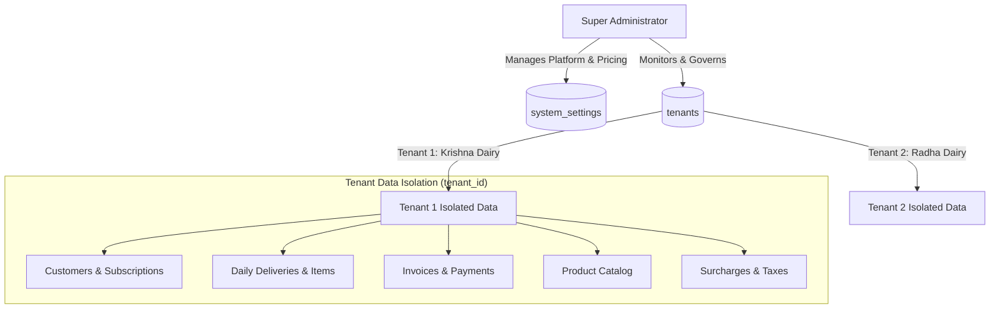
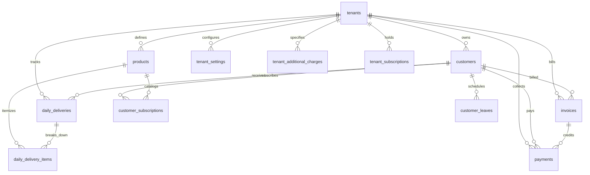

# DoodhDesk SaaS — Functional Specification Document

**Product Name:** DoodhDesk  
**System Type:** Multi-Tenant SaaS Web Application for Milkmen & Dairy Delivery Businesses  
**Technology Stack:** PHP 8.2+ (Strict Types), MySQL 8.0+ / MariaDB, Tailwind CSS, Alpine.js / HTMX, Dompdf  
**Document Version:** 1.0.0  
**Last Updated:** November 2026  

---

## Table of Contents
1. [Executive Summary & Business Objectives](#1-executive-summary--business-objectives)
2. [User Personas & Role Matrix](#2-user-personas--role-matrix)
3. [Multi-Tenancy Architecture & Security Isolation](#3-multi-tenancy-architecture--security-isolation)
4. [Functional Modules](#4-functional-modules)
   - [4.1 SaaS Governance & Super Admin Portal](#41-saas-governance--super-admin-portal)
   - [4.2 Authentication & Tenant Onboarding](#42-authentication--tenant-onboarding)
   - [4.3 Customer Management & Quota Guard](#43-customer-management--quota-guard)
   - [4.4 Product Catalog Management](#44-product-catalog-management)
   - [4.5 Daily Delivery Run-Sheet (Anti-Dispute Delivery Engine)](#45-daily-delivery-run-sheet-anti-dispute-delivery-engine)
   - [4.6 Customer Leave & Vacation Scheduling](#46-customer-leave--vacation-scheduling)
   - [4.7 Billing & Invoicing Engine](#47-billing--invoicing-engine)
   - [4.8 Printing, PDF Generation & WhatsApp Billing](#48-printing-pdf-generation--whatsapp-billing)
   - [4.9 Payments & Customer Ledger](#49-payments--customer-ledger)
   - [4.10 Tenant Business Settings, Surcharges & Taxes](#410-tenant-business-settings-surcharges--taxes)
   - [4.11 SaaS Subscription & Quota Upgrade](#411-saas-subscription--quota-upgrade)
5. [Database Schema & Data Dictionary](#5-database-schema--data-dictionary)
6. [Business Rules & Mathematical Formulas](#6-business-rules--mathematical-formulas)
7. [Non-Functional & UX Requirements](#7-non-functional--ux-requirements)
8. [Automated Test Suite Specification](#8-automated-test-suite-specification)

---

## 1. Executive Summary & Business Objectives

### 1.1 The Core Problem
Local milkmen, dairy farmers, and daily subscription delivery businesses face persistent end-of-month billing disputes:
- Customers claim: *"I was out of town for 4 days, why did you charge me?"* or *"You didn't deliver on Sunday morning."*
- Traditional paper diaries get lost, damaged by rain or milk spills, or have illegible handwritten notes.
- Surcharges (transport fee, bottle deposits) and taxes (GST) are calculated haphazardly.
- Milkmen lose 5% to 15% of monthly revenue due to billing friction, manual recalculations, and disputed bills.

### 1.2 The DoodhDesk Solution
DoodhDesk is a mobile-first, multi-tenant SaaS application purpose-built for the dairy delivery ecosystem:
1. **Zero-Dispute Real-Time Delivery Tracking:** Daily run-sheet with 1-tap toggling (`Delivered`, `Missed / Skipped`, `Customer On Leave`).
2. **Strict Zero-Charge Rule:** Skipped or leave days strictly log `0.00` quantity and `₹0.00` charge, eliminating billing disputes.
3. **Itemized Multi-Product Subscriptions:** Independent morning/evening shifts, quantities, and rates for Cow Milk, Buffalo Milk, Paneer, Curd, and Ghee.
4. **4-Step Billing Engine:** Automatically aggregates deliveries, applies active surcharges (flat, per-day, per-liter), calculates taxes (GST), and adjusts previous balances or advance payments.
5. **Multi-Format Invoicing:** Generates Single-Page A4 Tax Invoices, 58mm/80mm Thermal POS Receipts, downloadable PDFs, and 1-click WhatsApp bills with dynamic UPI QR codes.

---

## 2. User Personas & Role Matrix

| Role | User Description | Permissions & Responsibilities |
|---|---|---|
| **Super Administrator** | Platform owner / SaaS operator | Manages global platform settings (`system_settings`), configures free customer limits and paid tier pricing blocks, monitors all tenant dairies, suspends/activates tenants, and adjusts tenant quotas. |
| **Tenant (Dairy Owner / Milkman)** | Independent milk delivery vendor | Registers their dairy, manages customer subscriptions, runs daily morning/evening delivery run-sheets, sets product catalog rates, configures custom surcharges & taxes, generates monthly bills, records payments, and upgrades quotas. |
| **Customer (End-Consumer)** | Household receiving daily milk | Receives monthly itemized bills with day-by-day delivery matrix, scans UPI QR code to pay, notifies dairy of vacation dates. |

---

## 3. Multi-Tenancy Architecture & Security Isolation

DoodhDesk uses a **Single-Database Shared-Schema Multi-Tenant Architecture**:
- Every tenant-scoped entity (`customers`, `customer_subscriptions`, `products`, `daily_deliveries`, `daily_delivery_items`, `customer_leaves`, `invoices`, `payments`, `tenant_settings`, `tenant_additional_charges`, `tenant_subscriptions`) contains a mandatory `tenant_id` foreign key referencing `tenants(id)`.
- All database queries strictly scope data via `tenant_id = ?` to ensure **100% data isolation**. Tenant A can never view or manipulate Tenant B's customers, deliveries, or invoices.
- Composite indexes (e.g. `(tenant_id, delivery_date, shift)`, `(tenant_id, customer_id)`) guarantee high-speed query execution under concurrent tenant loads.



---

## 4. Functional Modules

### 4.1 SaaS Governance & Super Admin Portal
- **Access Route:** `/admin` (Protected by `admin` middleware).
- **Global Pricing Configuration:**
  - `free_customer_limit`: Maximum active customers allowed on the free plan (Default: `5`).
  - `paid_tier_unit_size`: Customer capacity per purchased block (Default: `100` customers).
  - `paid_tier_unit_price`: Price per block per billing period (Default: `₹200.00`).
  - `currency_symbol`: Global currency symbol (Default: `₹`).
  - `platform_name`: SaaS platform branding (`DoodhDesk SaaS`).
  - `support_email` & `support_phone`: Platform support details.
- **Tenant Management:**
  - View all registered dairies with customer counts and active quota.
  - 1-click **Suspend / Activate** toggle to restrict delinquent accounts.
  - Manual quota block override for enterprise accounts.

---

### 4.2 Authentication & Tenant Onboarding
- **Routes:** `/login`, `/register`, `/logout`, `/demo/{role}`.
- **Self-Service Registration:**
  - Vendor enters Business Name, Owner Name, Phone Number, Password.
  - Automatically initializes:
    1. Tenant record in `tenants`.
    2. Default `tenant_settings` with tax disabled and UPI placeholders.
    3. Default `tenant_subscriptions` with Free Tier (`5` customer quota).
    4. Default product catalog (`Cow Milk` @ ₹60.00, `Buffalo Milk` @ ₹70.00).
  - Immediate auto-login with welcome alert: *"Welcome to DoodhDesk! Your free account with 5 customer slots is ready."*
- **Quick Demo Switcher:**
  - 1-click bottom switcher bar for testing:
    - 🥛 **Krishna Dairy (Paid Tier):** 105 capacity, 6 active customers, GST 5%, custom surcharges, pre-generated invoices.
    - 🐄 **Radha Dairy (Free Tier):** 4/5 slots used, ready to test Quota Guard paywall.
    - 🛡️ **Super Admin Portal:** SaaS platform governance.

---

### 4.3 Customer Management & Quota Guard
- **Routes:** `/customers`, `/customers/create`, `/customers/{id}/edit`, `/customers/import`, `/customers/export`, `/customers/sample-csv`.
- **Customer Fields:**
  - Name, Phone, Address, Route Name (e.g., *Main Route*, *Green Valley Route*), Status (`active` / `inactive`).
- **Product Subscriptions:**
  - A customer can subscribe to multiple products simultaneously.
  - For each product:
    - **Quantity:** Specific liters/units (e.g., 2.0L Cow Milk, 1.0L Buffalo Milk).
    - **Shift:** `morning`, `evening`, or `both`.
    - **Custom Rate (Optional):** Specific negotiated rate overriding the dairy's default catalog rate. If left empty, catalog default rate is inherited.
- **Customer Quota Guard & Paywall:**
  - Calculated as: $\text{Remaining Slots} = \text{Max Allowed} - \text{Active Customer Count}$.
  - If a tenant attempts to create a new customer or activate an inactive customer when `Remaining Slots <= 0`:
    - Customer creation is blocked.
    - An upgrade paywall modal triggers directing the vendor to `/subscription`.
- **Bulk CSV Ingestion (Option A Architecture):**
  - Columns: `Name, Phone, Address, Route, Cow Qty (L), Cow Rate, Buffalo Qty (L), Buffalo Rate, Status`.
  - Automatically parses individual quantities and rates for Cow and Buffalo milk.
  - Automatically inherits product catalog default rates when rate columns are left empty.
  - Supports duplicate detection with an optional *"Update existing customers"* checkbox.
- **Customer CSV Export:**
  - Generates downloadable UTF-8 CSV with BOM for Microsoft Excel compatibility, exporting all customer details and active product subscriptions.

---

### 4.4 Product Catalog Management
- **Routes:** `/settings` (Product Catalog tab), `/settings/products`, `/settings/products/{id}/toggle`, `/settings/products/{id}/delete`.
- **Default Products:**
  - Cow Milk (`code: cow`, unit: `L`, default rate: ₹60.00).
  - Buffalo Milk (`code: buffalo`, unit: `L`, default rate: ₹70.00).
- **Custom Products:**
  - Milkmen can create additional dairy products (e.g. *Fresh Paneer (kg)*, *Pure Cow Ghee (kg)*, *Curd (kg)*, *Taaza Dahi (cup)*).
  - Configurable unit, default rate, active toggle, and custom sort order.

---

### 4.5 Daily Delivery Run-Sheet (Anti-Dispute Delivery Engine)
- **Routes:** `/deliveries`, `/deliveries/toggle`, `/deliveries/edit-quantity`, `/deliveries/bulk-deliver`, `/deliveries/stats-json`.
- **Interface & Operational Workflow:**
  - Date picker (defaults to today) and Shift toggle (`Morning` / `Evening`).
  - Route filter to organize delivery by delivery boy / sector.
  - High-contrast card for each customer on the route.
- **Action Buttons per Customer:**
  - 🟢 **Delivered:** Logs full scheduled quantity as delivered.
  - 🔴 **Skipped / Missed:** Logs customer as skipped. **Quantity is strictly 0.00L (Zero-Charge Rule)**.
  - 🟡 **Customer On Leave:** Automatically disabled and badged if an active leave range covers this date.
  - ✏️ **Edit Quantity Modal:** Allows custom quantity adjustment for that specific delivery shift (e.g. customer requested +1 extra liter).
- **"Mark All Remaining as Delivered":**
  - 1-click batch button to verify all pending active deliveries in the shift.
- **Zero-Dispute Guarantee:**
  - Deliveries are stored in `daily_deliveries` and itemized in `daily_delivery_items`.
  - If a shift is skipped or on leave, quantity is logged as `0.00`. Billing engines calculate `0.00 * rate = ₹0.00`.

---

### 4.6 Customer Leave & Vacation Scheduling
- **Routes:** `/customers/{id}/leaves`, `/customers/{id}/leaves/{leave_id}/delete`.
- **Functionality:**
  - Customer informs dairy owner of vacation: owner enters `start_date`, `end_date`, and optional `reason`.
  - Date range auto-detection: Whenever the delivery run-sheet falls within this window, the delivery record is automatically tagged as `leave` with `0.00` quantity.
  - Delivery run-sheet displays a prominent badge: *"On Leave until {end_date}"*.

---

### 4.7 Billing & Invoicing Engine
- **Routes:** `/invoices`, `/invoices/generate-batch`, `/invoices/generate-single`, `/invoices/{id}`.
- **Generation Modes:**
  - **Batch Generation:** Select month and year $\rightarrow$ generates invoices for all active customers in 1 click.
  - **Single Customer Generation / Regeneration:** Generate or recalculate a specific customer's monthly bill.
- **4-Step Billing Calculation Formula:**

$$\text{1. Product Deliveries Subtotal} = \sum_{\text{day}=1}^{N} \sum_{\text{product}} (\text{Delivered Qty} \times \text{Effective Rate})$$

$$\text{2. Additional Charges} = \sum (\text{Active Surcharges per Flat / Day / Liter})$$

$$\text{3. Tax Amount} = (\text{Taxable Subtotal} + \text{Taxable Surcharges}) \times \left(\frac{\text{Tax \%}}{100}\right)$$

$$\text{4. Final Amount Due} = \text{Product Subtotal} + \text{Additional Charges} + \text{Tax Amount} + \text{Previous Balance} - \text{Payments Received}$$

- **Daily Delivery Matrix (`breakdown_json`):**
  - Stores every single day's delivered quantity, skipped days, and product itemization in a structured JSON payload for permanent historical proof on invoices.

---

### 4.8 Printing, PDF Generation & WhatsApp Billing
- **Routes:** `/invoices/{id}/a4`, `/invoices/{id}/thermal`, `/invoices/{id}/pdf`.
- **Document Formats:**
  1. **Standard A4 Tax Invoice:**
     - Clean, professional single-page layout matching tax compliance requirements.
     - Dairy branding, GSTIN number, customer details, and invoice serial.
     - Itemized Product Summary table with HSN codes, quantity, units, and rates.
     - Full 31-day Delivery Calendar matrix displaying daily quantities and missed days.
     - Surcharges, GST tax breakdown, previous balance, advance adjustments, and final balance due.
     - Embedded Dynamic UPI QR Code for instant smartphone payment.
  2. **Thermal POS Receipt (58mm / 80mm):**
     - Ultra-compact monospace receipt for Bluetooth portable thermal printers used by milkmen in the field.
     - Includes daily totals, active charges, final amount, and thermal UPI QR tag.
  3. **Server-Side PDF Download:**
     - Rendered via Dompdf supporting download and offline storage.
  4. **WhatsApp 1-Click Bill Sharing:**
     - Generates pre-formatted `https://wa.me/{phone}?text=...` URI.
     - Prefills customer name, month, milk total, surcharge breakdown, total payable, and payment link.

---

### 4.9 Payments & Customer Ledger
- **Routes:** `/invoices/{id}/payment`.
- **Payment Recording:**
  - Amount, Payment Date, Method (`UPI`, `Cash`, `Bank Transfer`, `Cheque`), Reference / Transaction ID, Notes.
- **Invoice Status Lifecycle:**
  - `unpaid` $\rightarrow$ `partial` (if payment < invoice amount) $\rightarrow$ `paid` (when balance reaches 0).
- **Advance & Balance B/F:**
  - Excess payment carries forward as a credit balance on subsequent month's invoices.
  - Unpaid balance carries forward as `previous_balance`.

---

### 4.10 Tenant Business Settings, Surcharges & Taxes
- **Routes:** `/settings`, `/settings/profile`, `/settings/taxes`, `/settings/charges`, `/settings/charges/{id}/toggle`, `/settings/charges/{id}/delete`.
- **Dairy Profile:** Business Name, Owner Name, Phone, Address, Invoice Footer Note.
- **Tax Engine:**
  - Toggle Tax On/Off.
  - Tax Label (e.g. `GST`, `VAT`, `Sales Tax`).
  - Tax Percentage (e.g. `5.00`%).
  - Tax Number / GSTIN (printed on invoices).
- **Flexible Surcharge Engine:**
  - Add custom charges with 3 charging models:
    - `flat_monthly`: Fixed amount added to monthly bill (e.g., ₹50.00 Monthly Delivery Fee).
    - `per_delivery_day`: Multiplied by the actual number of days milk was delivered.
    - `per_liter`: Multiplied by the total delivered liters in that month.
  - `is_taxable` flag: Determines whether tax percentage applies to this charge.
- **UPI Digital Payments:**
  - Set UPI ID (e.g., `ramesh@okhdfcbank`).
  - Optional custom UPI QR code image upload.

---

### 4.11 SaaS Subscription & Quota Upgrade
- **Routes:** `/subscription`, `/subscription/upgrade`.
- **Tier Structure:**
  - **Free Tier:** 5 customers free forever.
  - **Paid Add-on Blocks:** ₹200 per 100 customer capacity increment.
- **In-App Quota Purchase Simulation:**
  - Milkman selects block quantity $\rightarrow$ simulates payment $\rightarrow$ instantly increments capacity and updates `tenant_subscriptions`.

---

## 5. Database Schema & Data Dictionary



### Table Specifications

#### 1. `system_settings` (Global Platform Governance)
| Column | Type | Constraints | Description |
|---|---|---|---|
| `id` | INT | PK, Auto Inc | Setting unique ID |
| `setting_key` | VARCHAR(50) | UNIQUE, NOT NULL | Setting identifier (e.g. `free_customer_limit`, `paid_tier_unit_price`) |
| `setting_value` | TEXT | NOT NULL | Serialized setting value |
| `updated_at` | TIMESTAMP | DEFAULT CURRENT_TIMESTAMP | Last modification timestamp |

#### 2. `super_admins` (Platform Administrators)
| Column | Type | Constraints | Description |
|---|---|---|---|
| `id` | INT | PK, Auto Inc | Super admin ID |
| `name` | VARCHAR(100) | NOT NULL | Admin full name |
| `email` | VARCHAR(100) | UNIQUE, NOT NULL | Admin login email |
| `password_hash` | VARCHAR(255) | NOT NULL | BCrypt password hash |
| `created_at` | TIMESTAMP | DEFAULT CURRENT_TIMESTAMP | Registration timestamp |

#### 3. `tenants` (Milkmen / Dairies)
| Column | Type | Constraints | Description |
|---|---|---|---|
| `id` | INT | PK, Auto Inc | Tenant unique ID |
| `business_name` | VARCHAR(150) | NOT NULL | Dairy trading name |
| `owner_name` | VARCHAR(100) | NOT NULL | Primary proprietor name |
| `phone` | VARCHAR(20) | UNIQUE, NOT NULL | Primary contact / login phone |
| `email` | VARCHAR(100) | UNIQUE, NULL | Contact email address |
| `password_hash` | VARCHAR(255) | NOT NULL | BCrypt password hash |
| `status` | ENUM | `'active'`, `'suspended'` | Account standing |
| `created_at` | TIMESTAMP | DEFAULT CURRENT_TIMESTAMP | Tenant registration date |

#### 4. `tenant_settings` (Dairy Business Configuration)
| Column | Type | Constraints | Description |
|---|---|---|---|
| `id` | INT | PK, Auto Inc | Settings record ID |
| `tenant_id` | INT | FK `tenants(id)`, UNIQUE | Scoped tenant ID |
| `tax_enabled` | TINYINT(1) | DEFAULT 0 | 1 = Taxes active, 0 = Taxes disabled |
| `tax_label` | VARCHAR(50) | DEFAULT 'GST' | Printed tax descriptor |
| `tax_percentage` | DECIMAL(5,2)| DEFAULT 0.00 | Applied tax percentage |
| `tax_number` | VARCHAR(100) | NULL | GSTIN or tax registration number |
| `upi_id` | VARCHAR(100) | NULL | VPA string for UPI payments |
| `upi_qr_path` | VARCHAR(255) | NULL | Filepath for uploaded custom QR code |
| `invoice_footer_note`| TEXT | NULL | Custom greeting on invoices |

#### 5. `products` (Tenant Product Catalog)
| Column | Type | Constraints | Description |
|---|---|---|---|
| `id` | INT | PK, Auto Inc | Product unique ID |
| `tenant_id` | INT | FK `tenants(id)` | Scoped tenant ID |
| `name` | VARCHAR(100) | NOT NULL | Product name (e.g. *Cow Milk*, *Buffalo Milk*) |
| `code` | VARCHAR(50) | NOT NULL | Unique code per tenant (e.g. `cow`, `buffalo`, `paneer`) |
| `unit` | VARCHAR(20) | DEFAULT 'L' | Measurement unit (`L`, `kg`, `cup`) |
| `default_rate` | DECIMAL(10,2)| DEFAULT 60.00 | Standard unit price |
| `is_active` | TINYINT(1) | DEFAULT 1 | Catalog availability flag |
| `sort_order` | INT | DEFAULT 0 | Ordering index in dropdowns |

#### 6. `customers` (Consumer Accounts)
| Column | Type | Constraints | Description |
|---|---|---|---|
| `id` | INT | PK, Auto Inc | Customer unique ID |
| `tenant_id` | INT | FK `tenants(id)` | Scoped tenant ID |
| `name` | VARCHAR(100) | NOT NULL | Customer name |
| `phone` | VARCHAR(20) | NOT NULL | Customer phone number |
| `address` | TEXT | NULL | Delivery street address / flat no |
| `route_name` | VARCHAR(50) | DEFAULT 'Main Route' | Assigned delivery sector/route |
| `milk_types` | VARCHAR(100) | DEFAULT 'cow' | Comma-separated active product codes |
| `status` | ENUM | `'active'`, `'inactive'` | Account delivery status |

#### 7. `customer_subscriptions` (Itemized Product Subscriptions)
| Column | Type | Constraints | Description |
|---|---|---|---|
| `id` | INT | PK, Auto Inc | Subscription ID |
| `tenant_id` | INT | FK `tenants(id)` | Scoped tenant ID |
| `customer_id` | INT | FK `customers(id)` | Customer ID |
| `product_id` | INT | FK `products(id)` | Subscribed product |
| `default_quantity` | DECIMAL(6,2)| DEFAULT 1.00 | Quantity per delivery |
| `custom_rate` | DECIMAL(10,2)| NULL | Overridden custom rate; if NULL, inherits `product.default_rate` |
| `shift` | ENUM | `'morning'`, `'evening'`, `'both'` | Delivery shift |
| `is_active` | TINYINT(1) | DEFAULT 1 | Active subscription flag |

#### 8. `daily_deliveries` & `daily_delivery_items` (Delivery Engine)
- **`daily_deliveries`**: Scoped by `tenant_id`, `customer_id`, `delivery_date`, `shift`. Records overall total quantity, status (`delivered`, `skipped`, `leave`), notes.
- **`daily_delivery_items`**: Scoped by `delivery_id`, `product_id`. Stores exact `quantity` delivered, `unit_price`, and `status`.

#### 9. `invoices` (Monthly Billing Ledger)
| Column | Type | Constraints | Description |
|---|---|---|---|
| `id` | INT | PK, Auto Inc | Invoice unique ID |
| `tenant_id` | INT | FK `tenants(id)` | Scoped tenant ID |
| `customer_id` | INT | FK `customers(id)` | Customer ID |
| `billing_month`| TINYINT | NOT NULL | Billing month (1 - 12) |
| `billing_year` | SMALLINT | NOT NULL | Billing year (e.g. 2026) |
| `total_units` | DECIMAL(10,2)| NOT NULL | Total quantity delivered across all days |
| `milk_subtotal`| DECIMAL(10,2)| NOT NULL | Sum of product deliveries |
| `additional_charges_total` | DECIMAL(10,2)| DEFAULT 0.00 | Sum of surcharges |
| `tax_amount` | DECIMAL(10,2)| DEFAULT 0.00 | Computed tax amount |
| `previous_balance` | DECIMAL(10,2)| DEFAULT 0.00 | Unpaid balance from prior months |
| `final_amount` | DECIMAL(10,2)| NOT NULL | Net balance due |
| `payment_status` | ENUM | `'unpaid'`, `'partial'`, `'paid'` | Current collection status |
| `breakdown_json` | JSON | NULL | Day-by-day delivery matrix payload |

#### 10. `payments` (Collections & Receipts)
| Column | Type | Constraints | Description |
|---|---|---|---|
| `id` | INT | PK, Auto Inc | Payment transaction ID |
| `tenant_id` | INT | FK `tenants(id)` | Scoped tenant ID |
| `customer_id` | INT | FK `customers(id)` | Customer ID |
| `invoice_id` | INT | FK `invoices(id)`, NULL | Linked invoice ID |
| `amount` | DECIMAL(10,2)| NOT NULL | Paid amount |
| `payment_date`| DATE | NOT NULL | Payment received date |
| `payment_method` | ENUM | `'cash'`, `'upi'`, `'bank_transfer'`, `'cheque'`, `'other'` | Payment mode |

---

## 6. Business Rules & Mathematical Formulas

### Rule 1: Strict Zero-Charge Enforcement
- If delivery status = `skipped` OR `leave`:
  - `quantity = 0.00`
  - `subtotal = 0.00`
- Missed days must be clearly printed in red/strikethrough on monthly invoices to eliminate customer billing disputes.

### Rule 2: Multi-Product Independent Rates
- If customer subscribes to both Cow Milk (1.0L @ ₹65.00) and Buffalo Milk (2.0L @ ₹75.00):
  - Each item is computed independently:
    $$\text{Day Total} = (1.0 \times 65.00) + (2.0 \times 75.00) = 65.00 + 150.00 = ₹215.00$$
- If `custom_rate` is `NULL`, it automatically falls back to `products.default_rate`.

### Rule 3: Surcharge Calculation Matrix
- $\text{flat\_monthly}$: Fixed amount added once per invoice:
  $$\text{Charge} = \text{Amount}$$
- $\text{per\_delivery\_day}$: Multiplied only by days with status = `delivered` ($\text{quantity} > 0$):
  $$\text{Charge} = \text{Delivered Days Count} \times \text{Amount}$$
- $\text{per\_liter}$: Multiplied by total liters delivered:
  $$\text{Charge} = \text{Total Delivered Liters} \times \text{Amount}$$

### Rule 4: Tax Computation
$$\text{Taxable Base} = \text{Milk Subtotal} + \sum(\text{Active Surcharges where } \text{is\_taxable} = 1)$$
$$\text{Tax Amount} = \text{Taxable Base} \times \left(\frac{\text{tax\_percentage}}{100}\right)$$

### Rule 5: Customer Quota Guard
$$\text{Allowed Customers} = \text{free\_customer\_limit} + (\text{purchased\_blocks} \times \text{paid\_tier\_unit\_size})$$
$$\text{Can Create/Activate} \iff \text{Current Active Customers} < \text{Allowed Customers}$$

---

## 7. Non-Functional & UX Requirements

1. **Mobile-First & Sunlight Readability:**
   - Designed for milkmen operating delivery motorbikes early in the morning in bright ambient outdoor light.
   - High contrast colors (e.g. solid slate-900 typography, deep emerald greens `#059669`, bold rose `#e11d48`).
   - Minimum tap target size of $48\text{px} \times 48\text{px}$ (`.tap-target`) for reliable thumb operation.
2. **Instant AJAX Toggling:**
   - Run-sheet operations leverage Alpine.js / HTMX for zero-reload delivery status changes.
3. **Application Security:**
   - Password Hashing: BCrypt standard (`PASSWORD_BCRYPT`).
   - SQL Injection Prevention: 100% prepared statements via PDO with parameter binding.
   - CSRF Protection: Synchronizer Token Pattern on all state-altering POST requests.
   - Cross-Site Scripting (XSS): All outputs sanitized through `e()` helper (`htmlspecialchars(..., ENT_QUOTES)`).
4. **Print & Thermal Optimization:**
   - Dedicated `@media print` CSS rules hiding navigation, flash messages, and UI chrome.
   - Specific pixel width targeting for 58mm (190px printable width) and 80mm (260px printable width) portable receipt printers.

---

## 8. Automated Test Suite Specification

The test suite in [`tests/test_suite.php`](file:///var/www/html/doodhdesk/tests/test_suite.php) automatically verifies all 13 core business rules across the platform:

| Test ID | Test Scenario | Verification Objective |
|---|---|---|
| **Test 1** | Tenancy Data Isolation | Verifies Tenant 1 cannot access, query, or mutate Tenant 2's data. |
| **Test 2** | Zero-Charge Rule | Confirms missed and leave days strictly log 0.00L with zero charges on invoices. |
| **Test 3** | Vacation / Leave Auto-Detection | Validates that date ranges in `customer_leaves` auto-pause run-sheets. |
| **Test 4** | Customer Quota Guard | Enforces 5-customer limit on free tier and blocks 6th active customer. |
| **Test 5** | Billing Engine 4-Step Formula | Tests base milk, surcharges, GST taxes, and previous balance calculations. |
| **Test 6** | Super Admin System Settings | Verifies updates to global platform settings in `system_settings`. |
| **Test 7** | Customer Milk Type Multiselect | Verifies Cow, Buffalo, and Both subscription flags. |
| **Test 8** | Delivery Calendar Matrix | Verifies the 31-day JSON matrix generated for invoice calendar tables. |
| **Test 9** | Customer CSV Import & Export | Verifies Option A product-specific CSV import/export ingestion. |
| **Test 10** | Product Catalog Management | Tests dynamic creation and toggling of tenant catalog products. |
| **Test 11** | Independent Subscriptions | Tests independent quantities and rates for Cow and Buffalo milk. |
| **Test 12** | Itemized Run-Sheet Tracking | Tests line items and zero-charge logging in `daily_delivery_items`. |
| **Test 13** | Multi-Product Invoicing | Tests invoice generation itemizing subtotals across multiple products. |

**To run the test suite:**
```bash
php8.4 /var/www/html/doodhdesk/tests/test_suite.php
```
